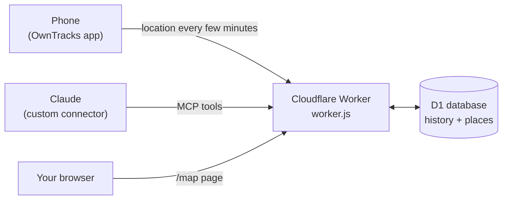

# lvts-tracker

**Track your vehicle with your phone, then just ask Claude where it is.**
Made in Suva, Fiji 🇫🇯 by [LomaVata Tech Services (LvTS)](https://fijianblood.github.io/lvts), *Living With Technology*.

LvTS uses it for its own Ford Ranger. It's a small [MCP](https://modelcontextprotocol.io) server that runs free on Cloudflare. Your phone sends its location with the free [OwnTracks](https://owntracks.org) app. Then you can ask Claude things like:

- "Where's the truck?"
- "How many km did I drive today?"
- "Show my trips yesterday."
- "Where was I at 10 am?"
- "Save this spot as Home."

It also gives you a private live map page you can open in any browser.



## What it can do

| Tool | What you get |
|---|---|
| `get_truck_location` | Where it is now, how long ago, street address, speed, moving or parked, phone battery |
| `get_trips` | Each drive for a day or time range: from, to, km, minutes, top speed, plus totals |
| `get_location_history` | The recorded path for any period, up to 31 days at a time |
| `list_places` / `save_place` / `delete_place` | Name your spots (Home, Town, Depot) so trips show names instead of map numbers |

Also included:
- **Live map page:** shows the route and the latest position, and refreshes every minute.
- **Times in Fiji time** by default.
- **Automatic clean-up:** points older than a year are deleted.
- **Works with old and new Claude connectors:** it supports MCP protocol **2026-07-28** (stateless, `server/discover`) and older clients that use the `initialize` handshake (2025-11-25, 2025-06-18, 2025-03-26).

## What you need

- A free [Cloudflare](https://dash.cloudflare.com) account.
- An Android phone or iPhone with **OwnTracks** installed. It's free.
- A [Claude](https://claude.ai) account that can add custom connectors.

> **It tracks the phone, not the vehicle.** Keep the phone in the vehicle, or use a spare phone that stays there.

## Set it up, no coding needed

### 1. Create the database
In Cloudflare, go to **Storage & Databases → D1 SQL database → Create Database**. Name it `truck-db` and click **Create**.

### 2. Create the Worker
1. Go to **Workers & Pages → Create application → Start with Hello World!**, then **Get started**.
2. Name it (for example `lvts-truck`) and click **Deploy**.
3. Open the Worker and click **Edit code**.
4. Delete everything in the editor, paste in all of [`worker.js`](worker.js), and click **Deploy**.

### 3. Connect the database
In your Worker, open **Bindings → Add binding → D1 database**.
- **Variable name:** `DB`, exactly, in capitals.
- **Database:** pick `truck-db`.

### 4. Add two secrets
In your Worker, go to **Settings → Variables and Secrets → Add**, set **Type** to **Secret**, and add both of these:

| Name | Value |
|---|---|
| `PHONE_PASSWORD` | A password you make up. You'll type it into OwnTracks. |
| `ACCESS_KEY` | A random code, **letters and numbers only**, at least 20 characters. Use a password generator. |

For both:
- **Use letters and numbers only.** The access key goes inside web addresses, and symbols like `/ # ? @` can break it.
- **Never post the key** in chats, screenshots or GitHub.
- **Don't reuse a password** you use anywhere else.

**Check it:** open `https://<your-worker>.workers.dev/`. It should say **connected** for the database and **set** for both secrets. The page never shows the secrets themselves.

### 5. Set up OwnTracks on the phone

| Setting | Value |
|---|---|
| Mode | **HTTP** |
| URL | `https://<your-worker>.workers.dev/owntracks` |
| Username / UserID | anything, for example `joe` |
| Password | your `PHONE_PASSWORD` (on iPhone, also switch **Authentication** on) |
| Device ID | for example `ranger` |
| Tracker ID | two letters, for example `JS` |
| Encryption key | leave **empty** |

On **Android**, the settings are under **☰ → Preferences → Connection**. On **iPhone**, tap **(i) → Settings**.

Then allow location all the time:
- **Android:** set **Location** to **Allow all the time**, and set **Battery** to **Unrestricted**. On Samsung, the battery setting matters.
- **iPhone:** set **Location** to **Always**, turn on **Precise Location**, and turn on **Background App Refresh**.

**Pick a mode** with the icon on the map screen:
- **Move:** a detailed route, but uses more battery. Good when the phone charges in the vehicle.
- **Significant Changes:** saves battery, but the route is rougher.

Tap **publish** (the arrow) to send a first location.

"Idle" on the iPhone status screen is normal in HTTP mode. The phone only connects for a moment each time it sends.

**Check it:** open `https://<your-worker>.workers.dev/map/<ACCESS_KEY>`. You should see an orange dot.

### 6. Add it to Claude
1. In Claude, go to **Customize → Connectors → + Add → Add custom connector**.
2. Fill in the form, then click **Add**.

| Field | Value |
|---|---|
| Name | `Truck Tracker` |
| URL | `https://<your-worker>.workers.dev/mcp` |
| Authentication | **No sign-in** |
| Request headers | Name: `Authorization`, Value: `Bearer <ACCESS_KEY>`. Leave one space after "Bearer". |

Using the header keeps your key out of the URL. Claude stores header values and never shows them again.

To use it in a chat, go to **+ → Connectors** and switch **Truck Tracker** on. Then ask: *"Where's the truck?"*

<details>
<summary>Simpler but less private: key in the URL</summary>

Use the URL `https://<your-worker>.workers.dev/mcp/<ACCESS_KEY>` with **No sign-in** and no headers. It works the same way. Just never share or screenshot that URL.
</details>

### Optional settings
- **Daily clean-up:** in **Settings → Trigger events**, add a cron trigger `0 15 * * *`. That's 3 am Fiji time, and it deletes points older than `RETENTION_DAYS`.
- **Variables** (plain text, not secrets):
  - `TIMEZONE`: default `Pacific/Fiji`.
  - `RETENTION_DAYS`: default `365`.

## Privacy and security

- **Your location stays in your own Cloudflare account.** Nothing is sent to LvTS or anyone else. The only exception is the address lookup: when Claude asks for the current location, the coordinates are sent to OpenStreetMap's Nominatim service to find the street name. You can turn that off per question with `include_address: false`.
- **Anyone who has your `ACCESS_KEY` can see where you are.** Keep it secret. If it leaks, change it in Cloudflare and update the connector and your map link.
- The phone needs `PHONE_PASSWORD` to send locations, and passwords are checked in a way that doesn't leak timing information.
- The map page tells search engines not to index it, and only sends your site's origin (not the key) to the map tile and script servers.

**If you fork this:** change `USER_AGENT` near the top of `worker.js` to your own site. The [Nominatim usage policy](https://operations.osmfoundation.org/policies/nominatim/) asks every app to identify itself.

## Limits

- **One vehicle.** Every location sent to the Worker counts as the same vehicle. If two phones send from different places, the positions will mix.
- **Rough trips in battery-saving mode.** Trip detection uses the phone's speed, or works it out from positions. In "Significant Changes" mode, trips are less exact.
- **Address lookups need internet.** If OpenStreetMap is slow or down, you still get the coordinates, just without the street name.

## For developers: test it on your computer

```bash
npm install
cp .dev.vars.example .dev.vars   # local test secrets only
npm run dev                      # runs the Worker with a local D1 database
npm test                         # in a second terminal: 59 end-to-end checks
```

The tests cover:
- the phone upload and its password check
- both MCP protocol styles: header validation, version errors, unknown methods and tools
- every tool, including trip detection with and without GPS speed
- the map page and its API
- the daily clean-up

To deploy with the CLI instead of the dashboard:
1. Run `npx wrangler d1 create truck-db` and put the `database_id` it gives you in `wrangler.toml`.
2. Set the secrets with `npx wrangler secret put PHONE_PASSWORD` and `npx wrangler secret put ACCESS_KEY`.
3. Run `npm run deploy`.

## Credits

- [OwnTracks](https://owntracks.org): phone app.
- [OpenStreetMap](https://www.openstreetmap.org/copyright) contributors: map data and tiles.
- [Nominatim](https://nominatim.org): addresses.
- [Leaflet](https://leafletjs.com): map page.
- [Cloudflare Workers and D1](https://developers.cloudflare.com/workers/): hosting.
- [Model Context Protocol](https://modelcontextprotocol.io): the connector standard.
- Built with help from Claude (Anthropic).

## About LvTS

**LomaVata Tech Services** is a locally owned IT and web business in Raiwai, Suva, Fiji. We do websites, PC and laptop repair, and PlayStation repair, and we build tools like this one.
Website: https://fijianblood.github.io/lvts

Vinaka for checking it out! Issues and pull requests are welcome.

## Licence

[MIT](LICENSE) © 2026 LomaVata Tech Services (LvTS)
